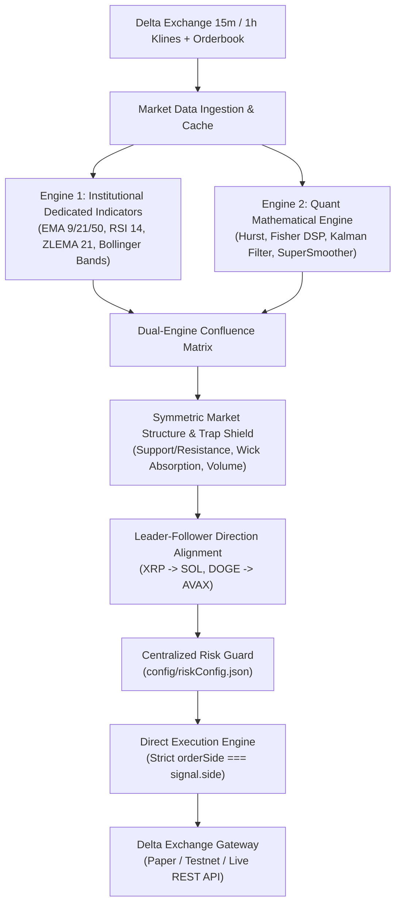

# 🚀 Delta Exchange High-Frequency Quantitative Trading Bot (Cryptobot)

An institutional-grade algorithmic cryptocurrency trading engine designed for Delta Exchange India perpetual futures. The system employs a **Dual-Engine Confluence Architecture** combining mathematical digital signal processing (DSP) and statistical physics with high-timeframe price action mechanics, strict market structure filtering, and automated risk management.

---

## 🏛️ System Architecture

The trading bot operates a unified, non-inverting dual-engine architecture:



### 1. Dual-Engine Confluence
* **Quantitative Mathematical Engine (`lib/quantMathematicalEngine.ts`)**: Evaluates market regime via Hurst Exponent (persistence vs mean reversion), Ehlers SuperSmoother digital filter, Fisher Transform velocity, Kalman estimation, and Support/Resistance zone confluence. Calibrated execution threshold: `>= 40` score.
* **Institutional Dedicated Indicator Engine (`lib/cryptoDedicatedStrategyEngine.ts`)**: Generates coin-specific technical setups using institutional EMAs (9, 21, 50, 100, 200), RSI-14 momentum curves, Zero-Lag Exponential Moving Averages (ZLEMA), and Bollinger Band mean-reversion reclaims.

### 2. Symmetrical Market Structure & Trap Shield
* Counter-trend setups are evaluated symmetrically: oversold capitulation floors and overbought blow-off tops are protected against naive entries.
* Confirmed support bounces and absorption wicks receive positive scoring without artificial macro-trend handicaps.
* Resistance rejections and support bounces are treated with identical mathematical rigor.

### 3. Absolute Signal Integrity Guarantee
* **Zero Signal Inversion**: Signals are executed with absolute directional fidelity (`BUY` signals always dispatch `BUY` orders, `SELL` signals always dispatch `SELL` orders).
* **Runtime Assertion Guards**: An explicit assertion `if (orderSide !== params.side) abort;` protects every order execution path in `server.ts` and `lib/deltaAutoTraderEngine.ts`.

---

## 🛡️ Risk Management (`config/riskConfig.json`)

All risk parameters are centralized and validated on startup:

```json
{
  "maxLeverage": 20,
  "maxConcurrentPositions": 1,
  "marginPercentPerTrade": 90,
  "maxDailyLossUSD": 10.0,
  "maxLossPerTradeUSD": 2.5,
  "targetProfitPerTradeUSD": 6.0,
  "minCapitalFloorINR": 500,
  "targetCapitalGoalINR": 4000,
  "enforceHardRiskLimits": true
}
```

### Safety Features:
* **Hard Leverage Ceiling**: Strictly capped at `20x` (refuses boot if configured higher).
* **Strict Concurrency Limit**: 1 concurrent active position (calibrated for ₹2,000 INR starting capital).
* **Risk-Based Position Sizing**: Every trade stop distance is guaranteed `>= 0.8 ATR`. Contract quantity is mathematically sized so that hitting the stop loss limits losses to exactly `$2.50 USD`.
* **Target Profit & Risk:Reward**: Guaranteed `1:2.4 R:R` targeting `$6.00 USD` profit per trade.
* **Emergency Survival Floor**: Trading automatically pauses if total account equity drops to or below `₹500 INR`.
* **Capital Profit Goal**: Trading automatically secures profits and pauses once equity reaches `₹4,000 INR`.

---

## 🪙 Supported Watchlist & Hierarchy

| Symbol | Role | Win Rate Benchmark | Behavior |
| :--- | :--- | :--- | :--- |
| **XRPUSD** | Supreme Leader | ~83.3% | Trades independently on highest conviction setups |
| **DOGEUSD** | Meme Leader | ~73.3% | Trades independently on momentum breakouts |
| **SUIUSD** | Independent | ~70.0% | Trades independently on volatility expansions |
| **SOLUSD** | Follower | - | Aligns with and copies XRP direction |
| **AVAXUSD** | Follower | - | Aligns with and copies DOGE direction |
| *BTC, ETH, ADA* | Inactive | - | Disabled to preserve margin for high-alpha altcoins |

---

## 📂 Repository Structure

```
├── config/
│   └── riskConfig.json               # Centralized startup-validated risk parameters
├── lib/
│   ├── deltaAutoTraderEngine.ts      # Core automated trading execution engine
│   ├── deltaExchangeEngine.ts        # Delta Exchange REST/WebSocket API client
│   ├── quantMathematicalEngine.ts    # DSP, Hurst, Fisher, Kalman, S/R quant models
│   ├── cryptoDedicatedStrategyEngine.ts # Dedicated indicator strategies (EMA/RSI/ZLEMA)
│   ├── smartReversalDetector.ts      # Symmetrical trap & exhaustion rejection detector
│   ├── priceActionPlaybook2026Engine.ts # Market structure (HH/HL/LH/LL), swing levels
│   ├── marketTrapsAndChopEngine.ts   # Choppiness index, false breakout detection
│   └── timingAndAntiChaseEngine.ts   # Entry timing, pullback Fibonacci optimization
├── scripts/
│   ├── cancelAllOrders.cjs           # Emergency open/bracket order cancellation utility
│   ├── checkCandles.cjs              # Kline data inspection and freshness checker
│   ├── diagnose_all_coins.cjs        # Live diagnostics across full altcoin watchlist
│   ├── showLiveProof.cjs             # Real-time state and trade inspection
│   └── checkDeltaPositions.ts        # Delta Exchange exchange positions verifier
├── tests/
│   ├── test_smart_direct_verification.ts # Master unit suite (direction & trap tests)
│   ├── testBothEngines.ts            # Live dual-engine scanner test
│   ├── testPlaybook2026.ts           # Market structure validation suite
│   └── testMarketTrapsLive.ts        # Live chop & trap evaluator test
├── src/
│   └── types.ts                      # Central TypeScript interfaces and data contracts
├── server.ts                         # Express backend & WebSocket server
└── package.json                      # Build & run scripts
```

---

## ⚙️ Execution Modes

The engine dynamically operates in three execution modes based on environment configuration:

1. **`SIMULATION_PAPER` (Default / Development)**:
   - High-fidelity simulated broker with real live tick data from Delta Exchange India.
   - PnL, stops, and take-profit orders calculated against live streaming prices.
   - Zero capital at risk.

2. **`DELTA_TESTNET`**:
   - Routes orders to Delta Exchange Testnet (`testnet-api.delta.exchange`).
   - Verifies network connectivity, signatures, and order flow.

3. **`LIVE_DELTA_INDIA`**:
   - Direct execution on Delta Exchange India (`api.india.delta.exchange`).
   - HMAC-SHA256 signature generation for real perpetual contract orders.
   - Automated server-side bracket order management (TP/SL).

---

## 📋 Pre-Live Production Checklist

Before running with live capital:

- [ ] **Private Repository**: Ensure this GitHub repository is set to **Private** to protect proprietary strategy IP.
- [ ] **API Keys Configured**: Add `DELTA_API_KEY` and `DELTA_API_SECRET` to your local `.env` file (never commit `.env`).
- [ ] **IP Whitelisting**: Ensure your server's outgoing IP address is whitelisted in Delta Exchange API settings.
- [ ] **Risk Parameters Verified**: Inspect `config/riskConfig.json` to confirm `maxLeverage: 20` and `maxConcurrentPositions: 1`.
- [ ] **Run Verification Suite**: Execute `npm test` and ensure all 32 assertions pass.
- [ ] **Verify Live Margin Balance**: Verify starting capital (e.g. ₹2,000 INR / ~$23.53 USD) via the web UI.

---

## 🛠️ Quick Start

### Installation
```bash
npm install
```

### Type Checking & Building
```bash
# Type check TypeScript codebase
npm run lint

# Build server bundle
npm run build:server
```

### Running Tests
```bash
# Run unit tests
npm test

# Run live market scanner diagnostic
node ./node_modules/tsx/dist/cli.mjs tests/testBothEngines.ts
```

### Starting the Server
```bash
# Production daemon
npm start

# Development mode with live reload
npm run dev
```

The web dashboard is served locally at `http://localhost:3001`.
